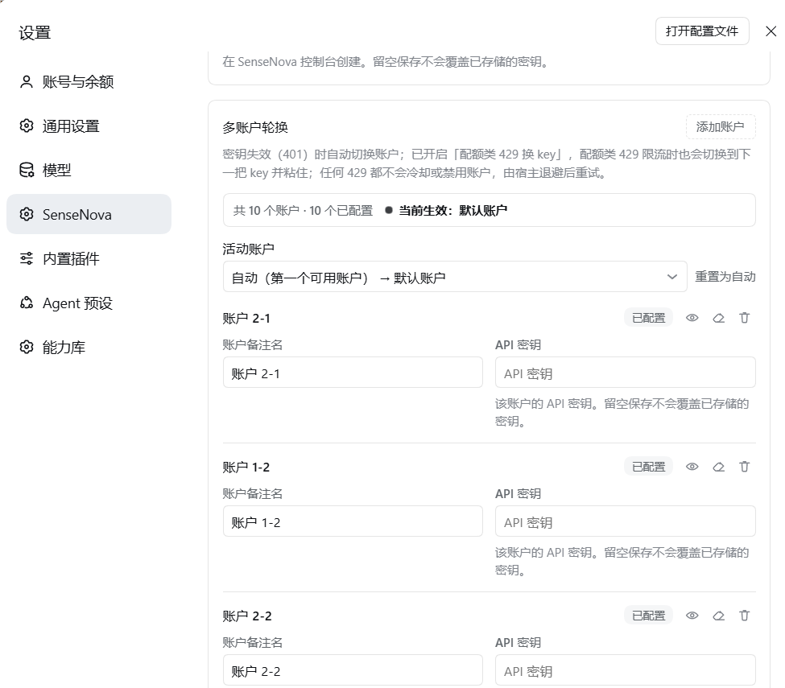

# dsh-sensenova-freeapi

[简体中文](./README.md) ｜ **English**

dsh-sensenova-freeapi is an unofficial **DeepSeek Harness** (DSH) LLM provider plugin. It registers the `sensenova` provider route via the **everything-is-a-plugin** architecture and talks to **SenseNova** (OpenAI-compatible API). It turns provider rate limits from "an error storm" into "a predictable rhythm": **account-by-account rotation, 4 keys per group probed in order, then a group pacing window** — plus a **visual console** so you can see the rhythm and tune it yourself.

<p align="center">
  
</p>


---

## What changed in v0.5

If you used an older version, these are the only things you need to know:

| Change | Details |
|---|---|
| 🔄 **Rotation rewritten** | The old "running / blocked dual-list + probe revival" state machine is gone. It is now **account-by-account rotation**: each turn probes only **4 keys of one account**, then hands over via the **group pacing window** — preventing 424 at the source. |
| 🎛️ **New console panel** | Visual key grid: drag group edges, inspect rotation order, one-click **Smart group**, one-click **Smart group gap**, plus a **Preview** that plays two rounds fast. |
| 👁️ **Vision aid merged in** | No separate plugin needed anymore (and no more two schedulers fighting over the same keys). Three vision tools + drag-and-drop auto-recognition ship in this plugin, individually switchable. |
| ⚠️ **AIMD not finished** | Use **fixed pacing only**. The AIMD hydration logic is still incomplete — do not use it, do not enable it yourself. |
| 📉 **Model recommendations removed** | Model performance swings hard **by time of day**, so a recommendation table is misleading. Instead you are taught how to **tune the group gap yourself** with the panel. |

---

## Installation & updates

### Via the DSH plugin UI (recommended)

1. Open DSH → **Plugins** in the left sidebar → **Add plugin**
2. Paste the repository URL:

```
https://github.com/modesthub/dsh-sensenova-freeapi
```

3. Confirm, then **restart DSH**
4. The **plugin detail page** shows the installed version (this README ships with **v0.5.1**)

### Updating

- Re-enter the same URL in the plugin install dialog (or uninstall and reinstall)
- **Restart DSH** afterwards; the version number on the plugin detail page is the simplest confirmation
- To pin a version, append a tag: `https://github.com/modesthub/dsh-sensenova-freeapi#v0.5.1`

### Command line (alternative)

```bash
# GitHub (recommended; lib/ is prebuilt, no build step needed)
dsh plugin --profile desktop add https://github.com/modesthub/dsh-sensenova-freeapi

# Local path (for plugin development)
dsh plugin --profile desktop add /path/to/dsh-sensenova-freeapi
```

---

## 🚀 Quick Start: Sign Up, Get Keys, Configure Accounts

### 1. Create a SenseNova account

Go to [https://platform.sensenova.cn/login](https://platform.sensenova.cn/login).

> ⚠️ **Sign-up and login currently accept a phone number only — email is not supported.** There is no email-code entry in the console, so don't waste time on that field.

### 2. Issue multiple API keys from the console

Open [https://platform.sensenova.cn/console/keys](https://platform.sensenova.cn/console/keys) → **API Keys**.

- **Up to 20 keys per account**
- Quota is **per account**: every key inside one account shares the same bucket
- Multiple keys buy you **more retry chances inside one bucket**, not more quota

> 📷 Where to issue keys in the console:

<p align="center">
  
</p>

### 3. Register multiple accounts (4 recommended)

Quota is **per account**, so spreading keys across **≥2 accounts** is the only way to escape a single-account bottleneck. Number of accounts = number of independent buckets.

- **Recommended: 4 accounts × 20 keys each** (80 keys total)
- The account count directly decides your **group pacing window** (see "Smart group gap" below)

### 4. Import keys

In the console panel click **Import to accounts**. Two formats are accepted:

```
# Format 1: per-account blocks
1
0:sk-xxxx
1:sk-xxxx
2:sk-xxxx

# Format 2: one line per key
1-0:sk-xxxx
1-1:sk-xxxx
```

Label format: `account-slot` (e.g. `2-3` = the 3rd key of account 2), `Default` equals `1-0`.

Importing automatically runs **Smart group** once (4 keys per group per account). Click **Save** at the top to persist and activate.

### 5. Pick a model

**The plugin no longer recommends models.** The reason is simple:

> Model performance swings violently by time of day (morning rush, evening rush and 3 a.m. are completely different), and every measurement burns real requests and real time — **the test window itself is a variable**. A recommendation table produced under those conditions only misleads you.

The correct approach: **pick whichever model you want, then tune the group gap with the panel** — it has **Smart group gap** and **Preview**, so you can see whether the rhythm fits.

Current model status (as of 2026-11):

| Situation | Details |
|---|---|
| `deepseek-v4-flash` | **Being retired** (its chapter is gone from the new official docs). Stop relying on it. |
| `deepseek-flash` (V4.1) | The **replacement** for `deepseek-v4-flash`. |
| Latency | Author's personal impression: both are in the **10–20 s** range. Anecdotal, not a benchmark. |
| `glm-5.3` | Zhipu's new flagship (coding / security). **Thinking is always on**, effort accepts only `low`/`high`/`max`. |
| `sensenova-6.8-flash-lite` | Lightweight multimodal, best for reading images, 262K context. |
| `sensenova-6.8-flash` | New multimodal agent model, 1M context, thinking always on. |
| `kimi-k3` | Native multimodal, 1M context, good for long-horizon coding. |
| `glm-5.2` | Superseded by 5.3; **kept registered** in the plugin (old configs keep working) and cleaned up in a later release. |

---

## 🎛️ The console panel

The **SenseNova Console** page in settings is the heart of this plugin:

### Accounts and groups (key grid)

One row per account, one square per key, groups enclosed in numbered frames (`1`, `1′`, `1″`).

| Action | How |
|---|---|
| **Change grouping** | Drag a group frame's **left/right edge** to move keys between adjacent groups |
| **Group menu** | Click a group label → merge into neighbour, take the whole group out of rotation, delete |
| **Account menu** | Click the account square at the row start → rename, delete |
| **Add a key** | Click an empty slot → fill the API key below → **Add key** |
| **Row-end +** | Turn trailing orphans into a new group, or split the last group |

Each row reserves 20 slots and expands automatically. Orphan keys (yellow dashed) belong to the account but **do not participate in rotation**.

### Preview

Plays the **real rotation order** at speed: each key turns green (request in flight) then red (429), and after the **429 round budget** is exhausted it shows the host throw.

Use it to check the ordering and that two rounds cover every key before you tune anything.

### Smart group

Re-slices every account into groups of **4** (a remainder forms its own group). **Runs automatically after import**, and can be redone manually anytime.

> Why 4: probing only 4 keys per turn is the empirical value that avoids triggering **424** (the upstream circuit breaker for *consecutive* rate limits). Want more or fewer per group? Drag the frames.

### Smart group gap

Recommends the group pacing window from your **actual account count**:

| Accounts | Recommended gap | (n−1) × gap |
|---|---|---|
| 1 / 2 | 60s | 0 / 60s |
| 3 | 30s | 60s |
| 4 | 20s | 60s |
| ≥5 | 20s (may lower manually) | ≥80s |

The invariant is `(accounts − 1) × gap ≥ 60s`: each account rests at least 60 seconds between two uses. The panel shows both the **recommendation** and the **manual lower bound** for your current account count.

### Scheduling (fixed pacing)

| Parameter | Default | Meaning |
|---|---|---|
| **Scheduling mode** | fixed | ⚠️ Use only this. AIMD is unfinished. |
| **Grouping shape** | one account per group | The alternative ("mixed accounts inside a group") favours throughput |
| **Key gap inside a group** | 1000 ms | Wait before switching to the next key of the same account |
| **Group pacing window** | 20000 ms | Minimum occupancy of one group per round |
| **429 round budget** | 2 | How many full sweeps may fail before the host throw (1–10) |

### Vision aid

Three tools (`describe_image` / `describe_images` / `chat`) plus drag-and-drop auto-recognition. **Toggling applies immediately** — no save needed. Disabling it leaves the main conversation untouched.

### Diagnostics / Current model

Read-only blocks: run log (rate-limit / vision / all filters) and the current model's capabilities and full parameter table. They never take part in the save flow.

---

## 🔄 Rotation (the core of v0.5)

The old version managed each key's phase with a "running / blocked dual-list" plus an external probe that revived keys from the blocked list — complex, with plenty of failure modes. v0.5 drops phase tracking entirely and drives everything by **pure pacing**.

### How one round works

With 4 accounts × 20 keys each × 5 groups of 4:

```
acct1 group1(4 keys) → acct2 group1 → acct3 group1 → acct4 group1
                 ↓ a finished group waits for the group pacing window
acct1 group2(4 keys) → acct2 group2 → acct3 group2 → acct4 group2
                 ↓
... until every account has walked through all 5 groups
```

**Three layers of rules:**

1. **Macro: cycle through accounts, never skip**
   Every macro cycle advances one step per account, in order. Account 1 finishes before account 2 starts. Skipping would squeeze two uses of the same account together — and rate limits chain per account.

2. **Micro: use that account's own group cursor**
   Each account tracks "which group is next". Accounts with fewer groups reuse the same group; that is by design.

3. **Inside the group: 4 keys in slot order**
   key 1 → 429 → wait the **key gap** → key 2 → … → key 4.
   Any success ends the group; four 429s also end it for this round.

### How the pacing window works

When a group finishes (success or four failures), the plugin records **when the group started** and requires that the group stay out of rotation until `startedAt + groupGapMs`.

- If the round only took 2 seconds but the window is 20 seconds → **wait out the remaining 18**
- While waiting, the cursor keeps moving to the next account's next group

So by the time rotation **comes back to the same group of the same account**, at least

$$(accounts - 1) \times groupGapMs$$

has elapsed. With 4 accounts × 20 s that is **60 seconds** between two uses of the same account. This is the whole meaning of the group pacing window.

### What happens after a 429

| Situation | Action |
|---|---|
| The group still has untried keys | Wait the **key gap**, switch to the next key |
| All 4 keys in the group failed | Account for it, take one macro step to the next account |
| Every account's current group is unavailable | Wait for the earliest available group, clear the "tried this round" set, start the next round |
| Round budget exhausted | Throw to the host with `pra = time until the earliest available group` |

**Why this avoids 424**: 424 (`bili_throttle_terminal`) is upstream's circuit breaker for **consecutive** rate limits. Once tripped, switching keys or accounts does nothing — you can only wait out the probe cycle (~30 s). The old "on 429, switch key immediately" logic could fire a dozen requests within a few hundred milliseconds, which is exactly what trips it. Now each group sends at most 4 requests with multi-second gaps between groups, so the breaker never gets a chance.

### ⚠️ About AIMD

The **AIMD (adaptive)** mode in the panel is **not usable right now**: its "inflate the gap on every 429" logic shares state with fixed mode and the hydration is incomplete. **Use fixed pacing.** Please also don't enable it by editing the code — there will be no large updates in the near term.

---

## 👁️ Vision aid (merged)

The old version required installing `dsh-sensenova-vision-aid` separately; two rotation domains competed for the same keys, so **the main conversation and vision requests rate-limited each other**.

Vision is now built in:

| Capability | Description |
|---|---|
| `describe_image` | Single-image understanding / OCR |
| `describe_images` | Multiple images in one request |
| `chat` | Plain text (connectivity check / fallback) |
| Drag-and-drop auto-recognition | Images dropped into a text-only model are first converted to a "visual observation" text block |

The key property: **vision requests share the same key pool, the same concurrency gate and the same group backoff as the main conversation.** Rate-limit events go to the same run log.

**If you don't want it**: untick **Enable vision aid** in settings — effective immediately. Dragged images then go to the main model as-is (official vision models can see them; text-only models are rejected by the host), i.e. the same behaviour as having no vision plugin installed.

---

## 🔑 Key import / export

**Export**: click **Export all keys** → every account's keys (including the default one) appear in the textbox as plaintext:

```
# dsh-sensenova-freeapi key export — 2026-11-12T00:00:00.000Z
Default:sk-...

账户2
0:sk-...
1:sk-...
```

**Import**: paste the text → **Import to accounts** → **draft only** (the Save button lights up) → click **Save** to write credentials.

- Same label as an existing account → overwrite that account's keys
- New label → allocate a new credential-ref and append the account
- Duplicate keys and malformed lines are skipped with a message (other lines still import)

> 🔒 The exported text is **plaintext keys**: it is shown only in the local settings page; the plugin never uploads or persists it. Export goes through the host-only route `GET /api/sensenova/keysExport` (the client cannot read keys directly; the host resolves them).

---

## UI buttons at a glance

| Button | Location | Purpose |
|---|---|---|
| **Reset / Save** | Right of the page title | Discard unsaved edits / save all drafts |
| **Refresh** | Right of the title | Force re-read of every credential state (use it when the grid looks off after import) |
| **Clear all** | Right of the accounts header | After a second confirmation, stage removal of every extra account; takes effect on Save |
| **Preview** (红/绿) | Top of the group editor | Play two rounds in real order, fast |
| **Smart group** | Same | Re-slice each account into groups of 4 |
| **Smart group gap** | Scheduling card | Write the recommended gap for your account count |
| **Export all keys / Import to accounts / Clear box** | Import/export card | See above |
| **Refresh** (diagnostics) | Diagnostics card | Fetch recent run log entries |

---

## Configuration

| Field | Type | Default | Meaning |
|---|---|---|---|
| `apiBase` | string | `https://token.sensenova.cn/v1` | Base URL shared by all accounts |
| `apiKeyEnv` | credential-ref | `SENSENOVA_API_KEY` | Credential ref of the default account |
| `accounts[]` | array | `[]` | Extra accounts: `{ id, label, apiKeyEnv }` |
| `activeAccount` | string | `""` | Preferred account id; empty = automatic |
| `quotaRotation` | bool | `true` | Rotate keys on quota-type 429 (keep on) |
| `concurrency` | int | `1` | Per-key concurrency limit (FIFO queue beyond it) |
| `queueTimeoutMs` | int | `60000` | Queue wait ceiling |
| `errorLog` | bool | `true` | Write rate-limit events to the run log |
| `scheduling.mode` | enum | `fixed` | ⚠️ Use `fixed` only; `adaptive` (AIMD) is unfinished |
| `scheduling.grouping` | enum | `by-account` | One account per group / mixed accounts per group |
| `scheduling.groups[]` | array | `[]` | Per-account split `{ account, sizes[], gaps[] }` |
| `scheduling.keyGapMs` | int | `1000` | Wait between keys inside a group |
| `scheduling.groupGapMs` | int | `20000` | Group pacing window (min occupancy per group) |
| `scheduling.roundBudget` | int | `2` | Full sweeps before throwing to the host |
| `vision.enabled` | bool | `true` | Vision master switch (immediate) |
| `vision.modelChain` | string | `sensenova-6.8-flash-lite,deepseek-flash,kimi-k3` | Vision failover chain |
| `vision.bridgeMode` | enum | `on` | Drag-image bridge: `on` / `auto` / `off` |
| `poolPolicy.capacity` | int | `100` | Key pool capacity |

> API keys are always stored through the DSH credentials service: **never logged, never sent to a model**.

---

## Tuning guide (instead of model recommendations)

Since model performance varies by time of day, **the only reliable approach is to measure it yourself**:

1. Run **Smart group** — 4 keys per group per account
2. Click **Smart group gap** — write the recommended value for your account count
3. Click **Preview** — confirm two rounds cover every key and the account rotation is coherent
4. Use it for a while and watch the rate-limit log
   - 429s are dense → raise the group gap (try +5 s or +10 s)
   - Few 429s but slow responses → the gap may be lowered slightly
5. **Key gap inside a group**: default 1000 ms. Lower it to rotate faster; 0 means four back-to-back requests, which the gateway may treat as a burst

Every request logs its pacing parameters: `schedMode` / `schedKeyGapMs` / `schedGroupGapMs` / `schedWaitMs` (actual wait) / `schedStep` (which key in the group). Check them under **Diagnostics → Run log** to confirm the real rhythm matches your settings.

---

## Development

```bash
pnpm install
pnpm run typecheck
pnpm run build    # tsdown → lib/
pnpm test         # node --import tsx --test tests/**/*.test.ts
```

---

## Changelog

Oldest → newest.

- 🎉 **v0.2.0**: 429 pipeline rework (in-place retry first / per-model wait) + capacity 100 + multi-account 20-key measurements.
- 🎯 **v0.2.1**: key import / export (host-only export route + settings import panel).
- 🛠️ **Fixed in v0.2.2**: importing new accounts no longer reports a false "write failed" — now trusts `credentials.set`.
- 🛠️ **Fixed in v0.2.3**: bulk import froze the page — credential broadcasts debounced to 200 ms, refresh suspended during the import loop.
- 🛠️ **Fixed in v0.2.4**: credential-state queries batched (25 per call) + draft-based import + manual refresh button.
- 🧹 **v0.2.5**: clear-all-accounts / clear-box (staged, second confirmation).
- ⚡ **v0.2.6**: rotation order auto-interleaved at runtime (sorted by label's slot → account).
- 🩺 **v0.2.7**: key pool status indicator + collapsible account list + pool seed diagnostics.
- 🐛 **v0.2.8**: `quotaRotation` defaults to on + unconditional pool-state reporting on 429 (fixes "80 accounts stuck on Default").
- 🎛️ **v0.2.9**: wired the `connectRetry` config entry (in-place 429 wait can finally be turned off).
- 🚀 **v0.5.0**: **rotation rewritten** — account-by-account cycling with 4 keys per group plus group pacing, replacing the running/blocked dual-list state machine; brand-new console panel (draggable key grid, Smart group, Smart group gap, Preview, 429 round budget); **vision aid merged** (three tools + drag bridge, sharing the key pool); live request flashing; key import/export reworked.
- 🔧 **v0.5.1**: added `sensenova-6.8-flash` and `glm-5.3` (thinking always on, efforts limited to low/high/max); `glm-5.2` and `deepseek-v4-flash` stay registered (retired models are kept until a later cleanup). Full README rewrite (new rotation / console panel / merged vision / AIMD warning / no model recommendations) and removal of the dual-list state-machine diagram.

---

## License

MIT
