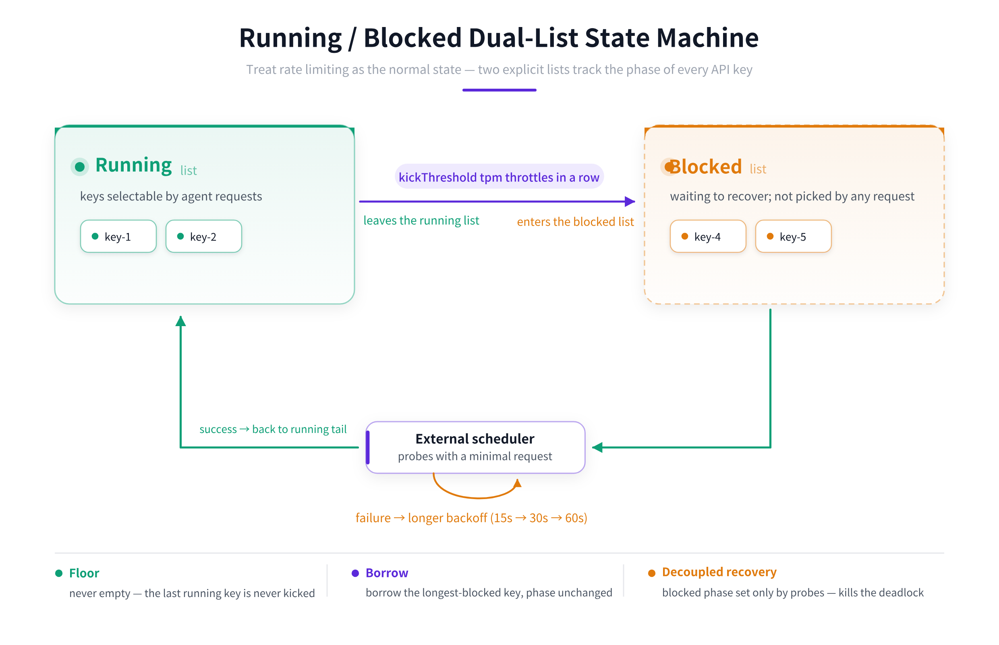

# dsh-sensenova-freeapi

[简体中文](./README.md) ｜ **English**

dsh-sensenova-freeapi is an unofficial **DeepSeek Harness** (DSH) LLM provider plugin. Built on the **everything-is-a-plugin** architecture, it registers the `sensenova` provider route to connect to **SenseNova** (an OpenAI-compatible API). It ships with **multi-account API-key rotation**, a **running/blocked dual-list state machine**, a live model catalog, and a Models-page settings panel, turning channel rate-limit spam into a stable service.

<p align="center">
  
</p>


> Reference implementation: [`@mars-sea/dsh-commandcode-provider`](https://github.com/Mars-Sea/dsh-commandcode-provider) (MIT). This plugin keeps only the multi-account connectivity; the login flow, usage dashboard, plan window, and CLI tooling are all trimmed away.

---

## 🚀 Quick Start: Sign Up, Get Keys, Configure Accounts

### 1. Create a SenseNova account

Sign up and log in at [https://platform.sensenova.cn/login](https://platform.sensenova.cn/login).

### 2. Issue multiple API keys from the console

Open the console at [https://platform.sensenova.cn/console](https://platform.sensenova.cn/console), then create keys under **API Key management**. **Each account allows up to 20 keys.** Note that the allowance is metered **per account** (all keys in one account share a single bucket), but multiple keys in the same account significantly raise the number of "draws" — measured: 20 keys in one account succeed ~90% of the time vs 30% with a single key.

> 📷 Account configuration screen (where to issue multiple API keys):

<p align="center">
  
</p>

### 3. Register multiple accounts (4 recommended)

SenseNova limits are **account- / endpoint-scoped** — multiple keys inside the *same* account share a single quota bucket. So spreading keys across **≥ 2 accounts** is what actually bypasses the single-account bottleneck.

- **Accounts are the key lever**: each account owns an independent quota bucket, so account count = bucket count. Measured: 4 accounts × 20 keys = 4 independent buckets × 20 draw chances, lifting the success rate from ~30% (single key) to ~100%.
- This plugin's running/blocked dual-list + account rotation is built exactly for the multi-account case.

### 4. Account order: the plugin interleaves accounts automatically

Configure accounts in any order — at rotation time the plugin re-sorts by the label's “slot → account” pair, producing a cross-account interleaved order:

```
A1  B1  A2  B2  A3  B3  …  (i.e. 121212 alternating)
```

This naturally staggers every key so rotation never spins inside one account, greatly lowering the chance of hitting a single account's ceiling.

- **Recommended setup: 4 accounts × 20 keys each** (SenseNova allows up to 20 keys per account).

  Measured (2026-10 peak hour, 10 rounds):

  | Keys in one account | Success rate | Expected time |
  |---|---|---|
  | 1 key | 30% | 27.9s |
  | 5 keys | 40% | 27.1s |
  | 10 keys | 40% | 27.8s |
  | 15 keys | 70% | 21.9s |
  | **20 keys** | **90%** | **17.2s** |

  **The knee is at 15-20 keys**; 20 keys in one account ≈ 20 keys across accounts (90% vs 100%). With 20 keys per account, 4 accounts give 4 independent buckets × 20 chances — rarely failing even at peak.

### 5. Recommended models

The following are taken from long-running measurements (2026-09), ordered by use case:

| Model | Capability / Notes | Rating |
|---|---|---|
| **`deepseek-v4-flash`** | **First choice.** DeepSeek V4 Flash (0731); only *slightly* slower than the official DeepSeek API at any time of day; low-cost, 1M context, thinking + tool-calling | ⭐⭐⭐⭐⭐ |
| `sensenova-6.8-flash-lite` | `6.8-flash-lite` uses a lightweight dedicated quota pool, has **real vision** (the only reliable one for reading images/screenshots), and the fastest wall-clock (26.6× speedup) | ⭐⭐⭐⭐⭐ (vision first) |
| `kimi-k3` | Moonshot flagship multimodal agent; native vision + 1M context; good for long-horizon coding and knowledge work | ⭐⭐⭐⭐ |
| `glm-5.2` | Zhipu long-horizon model; **highest sustained throughput** (201% faster than `deepseek-flash`, 45% lower latency), but **no vision** (hallucinates on images) | ⭐⭐⭐⭐ (text/long-run) |
| ⚠️ `deepseek-flash` (DeepSeek V4.1 Flash) | **Not recommended:** very slow at peak, and only reaches ≤ half the official API speed even off-peak | ❌ |

> 💡 **Bottom line:** use `deepseek-v4-flash` for daily/code/agent work; `sensenova-6.8-flash-lite` when you need image understanding; `glm-5.2` for pure-text maximum throughput. **Avoid `deepseek-flash` (V4.1).**

> 🔭 **Pairing recommendation (vision assist):** run the main model on `deepseek-v4-flash` (fast, stable, low-cost) and leave image recognition to the vision-assist plugin — install [`dsh-sensenova-vision-aid`](https://github.com/modesthub/dsh-sensenova-vision-aid), which spawns a child agent switched to the SenseNova vision model (`sensenova-6.8-flash-lite` → `deepseek-flash` → `kimi-k3` failover) and **reuses this plugin's key automatically** (default `reuseFreeapiCredentials=true`, no second key needed). **Best combination: `deepseek-v4-flash` for text/code/agent work + vision-aid for images — fast and reliable.**

---

## Core idea: design around throttling as a norm

SenseNova imposes **TPM / RPM concurrency and quota limits** per key, and a burst over the limit returns `429`. Most plugins just retry, which collapses into a **positive-feedback deadlock** under sustained throttling: the counter only resets on 2xx → short-circuiting yields zero success → the counter never resets → short-circuit never lifts → the process must be restarted.

This plugin flips the thinking: **throttling is not an accident, it is the steady state.** Two explicit lists manage the state of every API key:

### Running / Blocked dual-list state machine

<p align="center">
  
</p>

Three non-negotiable properties (the essential difference from the legacy whole-pool short-circuit):

1. **Floor** — when only 1 key remains in running, it is never kicked ⇒ the pool never empties and agent requests always go out.
2. **Borrow** — when running candidates are all excluded, borrow the *longest-blocked* key temporarily (**without changing its phase**).
3. **Recovery decoupled from requests** — a blocked key's phase is decided **only by probe results**, never polluted by "zero success", so it can be revived at any time. **This is what roots out the old deadlock.**

> Why probing must exist: agent requests only ever target running keys — a blocked key is never hit. Unless someone probes it, it can never recover. The scheduler probes once every `probeInitialMs` (default 3s, the same order as the request-bucket refill cycle) with a minimal request, and revives the key on success.

---

## Rotation: retry in place first, then switch keys

**Full 429 handling pipeline**:

1. **In-plugin retry in place** — wait on the same key for `deepseek-flash` 15s / `deepseek-v4-flash` 10s, at most once. On success: continue, no key switch, no log noise.
2. **Key rotation** — if it still fails and `quotaRotation=true` (recommended), scan the **running list** round-robin from the position after the last-used key, skipping keys already tried in this request (`exclude`). This avoids the legacy "first two ping-pong, key #3+ never used" bug.
3. **Borrow from blocked** — when all running candidates are excluded, borrow the *longest-blocked* key temporarily (**without changing its phase**), so a round can still try every key.
4. **Throw to host** — only when every key fails (exponential backoff 15-19s, up to 24 retries).

**Measured comparison (6 forced-429 rounds, deepseek-flash / 80 keys / 24k tokens)**

| Strategy | Success | Avg time (success) | Range |
|---|---|---|---|
| **`quotaRotation=true`** (15s retry, then key rotation) | **6/6 (100%)** | **27.9s** | **25.9-28.7s** |
| `quotaRotation=false` (15s retry, no key switch) | 4/6 (67%) | 36.9s | 27.4-46.4s (2 failures at 50s) |

> Why rotation is faster: a key switch costs **0.2s each** (2-4 keys usually hit), while host backoff costs **17s per retry**. Even with more 429s, rotation stays at "15s wait + 12-15s generation" ≈ 28s; without rotation you can only wait for host backoff — two retries already cost 45-50s, or fail outright.

**Rotation order (auto-interleaved since v0.2.6)**: when labels look like `account-slot` (`Default` counts as `1-0`), the plugin sorts by **(slot, account)** before rotating: `1-0 → 2-0 → 3-0 → 4-0 → 1-1 → 2-1 …`. The first 4 attempts therefore cover **4 independent quota buckets**, whereas a config-ordered list (all 20 keys of one account first) spends its first 19 attempts in a single bucket. Measured over 18 rounds (20-attempt cap): **interleaved 72% vs sequential 50%** success; on throttled rounds interleaved needed 10 attempts vs 16. Labels outside this format keep the configured order.

**States and throttle classification**:

- Only **tpm-type 429s** accumulate consecutive strikes; after `kickThreshold` (default 2) the key is kicked into the blocked list. `rpm` / `rate` throttles are recorded but never kick (their buckets heal in seconds; kicking only loses prompt cache).
- **Floor** — when only 1 key remains in running, it is never kicked; the pool never empties and agent requests always go out.
- **401 (invalid credential)** — permanently disabled and removed from the pool, regardless of `quotaRotation`.
- **Session stickiness** — after a rotation the session sticks to the new key (protects the server-side prompt cache); a successful request clears stickiness so the round-robin cursor drives the next pick.
- **Probe limitation** — the blocked-key probe is a minimal request (`max_tokens: 1`, thinking off), so it only reflects the request-count bucket, not full TPM recovery of large requests; real availability of large requests is judged by the agent request itself.

---

## Why it "runs stably over the long term"

None of the key parameters are guesses; they were **calibrated in long-running measurement**:

| Measured item | Conclusion | Basis |
|---|---|---|
| 429 order | **In-plugin retry once first, then switch keys** (deepseek-flash 15s / v4-flash 10s) | 6 forced-429 rounds: 100% vs 67% success, 27.9s vs 36.9s |
| `quotaRotation` | **On** (key switching is a cheap lottery: 0.2s per key) | Same test: without it the host backs off 17s per retry, hitting 45-50s after two rounds |
| Keys per account | 20 keys reach **90%** success (single key 30%); knee at 15-20 | 10 rounds × 5 levels, peak hour |
| Pool capacity | **100** (fits 4 accounts × 20 keys) | 2026-10 expansion measurement |
| Probe interval | **Fixed 3s** (`probeBackoffFactor=1`, no growth) | Tightened: recovers blocked keys faster |
| Probe scheduling | At most 1 key probed per tick (avoid probe-induced bursts) | by design |
| Dual-list state machine | Replaces the whole-pool-saturation positive-feedback deadlock | refactor |
| Wrap-around rotation fix | After an exclusion, wrap from the next position | 9265 logged 429s |
| Retry-After cap | raised to `60_000ms` (original 3000ms mismatched the TPM 60s window) | long-run |
| Queue timeout | default 60s, aligned with the TPM window | design D4/D6 |

---

## Feature overview

### 🧠 Dual-list key pool (running / blocked)
- Pool-level singleton, shared across sessions: a key's quota is a global property and must not be session-isolated.
- Consecutive-throttle kick-out, floor-never-empty, longest-blocked borrowing, probe recovery, fixed 3s probe — all configurable.
- Each key's state (phase, strikes, blockedSince, probeAttempts) is read-only in the settings page.

### 🔄 Rotation
- Default account + extra accounts, same base URL.
- Wrap-around rotation + sticky key-switch on quota-type 429s + permanent disable on 401.
- A disabled key auto-recovers when its credential changes.

### 📋 Error log table (read-only diagnostic block)
- Every throttle becomes a structured event, written asynchronously — **never blocks, never throws**.
- Fields: `time / model / error.code / account fingerprint / retryFloorMs / probeHits / poolRunning / poolBlocked / rotated / attempt`.
- Keys live only in memory; logs write only **sha256 fingerprints**; raw keys never touch disk or leave the machine.

### 📊 "Current model + all parameters" panel (read-only visualization)
- Answers: **which model am I using? what does it support? which parameters can I change?**
- Sourced from the host's actual parsing plus multiple measurement rounds.

---


### 🔑 Key import / export (v0.2.1)
- **Export**: pull every account key (default included) into the text box in `account N` groups — local only, never uploaded.
- **Import**: paste `account N + index:key` groups or single `label:key` lines → **staged as a draft** (the Save button lights up); press Save to actually write the credentials and update accounts. A label matching an existing account overwrites that key.
- Export goes through the host-only route `GET /api/sensenova/keysExport` (the client never sees plaintext); import writes the credentials store and updates `accounts` directly.
- **Clear**: “Clear box” empties the import/export text; the accounts card gains “Clear all” — after a second confirmation the extra accounts are **staged for removal**; press Save to actually delete the accounts and their credentials (the default account is kept).
## Key import / export (v0.2.1)

The settings page gains an **Import / export keys** card below the credentials block:

**Export** — click “Export all keys”: every account key (default included) is written as plain text into the box, in the same format as a hand-maintained key file:

```
# dsh-sensenova-freeapi key export — 2026-10-26T00:00:00.000Z
Default:sk-...

账户2
0:sk-...
1:sk-...
```

**Import** — paste that text (or your own `account N / index:key` or `label:key` lines) and click “Import into accounts”:
Import **only stages a draft** — the page-level **Save** button lights up; pressing it writes the credentials and updates the account list (`accounts`).


- a label matching an existing account overwrites that key (structure unchanged)
- a new label allocates a fresh `SENSENOVA_API_KEY_N` ref and appends an account
- `Default` / `1-0` writes the default account
- duplicate keys and malformed lines are skipped with an inline notice (other lines still import)

## UI buttons at a glance

| Button | Location | What it does |
|---|---|---|
| **Export all keys** | Import / export keys card | Pulls every account key (default included) into the text box as plain text |
| **Import into accounts** | Same card | Parses the text and writes it as a **draft** (Save lights up; nothing is written until you save) |
| **Clear box** | Same card | Empties the import / export text box |
| **Refresh** | Top-right of the page title | Re-queries every account's credential state manually (fallback; normally automatic) |
| **Clear all** | Right of the multi-account card title | After a second confirmation (within 3 s) **stages every extra account for removal**; press Save to delete accounts + unset their credentials. The default account is kept |
| **Save / Reset** | Page bottom | Save all drafts (import, clear, edits) / discard unsaved changes |


> 🔒 Exported text contains **plaintext keys**: it is shown only in your local settings page, never uploaded or persisted by the plugin. Store it wherever you trust (a password manager is a good default).

> 🛠️ **Fixed in v0.2.2**: importing new accounts no longer reports a false “write failed” — the old code judged by a `describe` round-trip before the new ref existed in the settings snapshot. It now trusts `credentials.set` and refreshes state once accounts are persisted.

> 🔄 **Top “Refresh” button**: re-query every account's credential state manually (a fallback; normally state refreshes automatically).

> 🛠️ **Fixed in v0.2.3**: bulk import no longer freezes the page — the host broadcasts `credentials/reference-updated` per key, and the old code re-described **all** refs after every write (80 keys → 80 full queries). Event handling is now debounced to 200 ms, the import loop suspends refreshes entirely and does a single describe at the end, and a “settings not ready” guard prevents an import from overwriting the existing account list.

> 🛠️ **Fixed in v0.2.4**: (1) credential-state queries are now **batched (25 refs per call)** — describing 80+ refs in one go was rejected/timed out, which surfaced as “80 accounts · 0 configured”; (2) import is now a **draft flow** (Save button lights up, nothing is written until you save); (3) a manual **Refresh** button was added at the top.

> 🧹 **v0.2.5**: added “Clear all accounts” and “Clear box”. Clearing is **staged**: after a second click within 3 s the rows disappear and Save lights up; pressing Save deletes the accounts and unsets their credentials. “Reset” undoes it.

> ⚡ **v0.2.6**: rotation order is now **interleaved at runtime** (sorted by the label's “slot → account” pair). Sequential orders produced by bulk import no longer hurt throughput — **no need to re-import existing configs**. Measured: 72% vs 50% success; on throttled rounds 10 vs 16 attempts.

> 🩺 **v0.2.7**: (1) key pool status indicator (current key / next key dimmed / pool counts + a flash animation on 429 rotation); (2) account list collapses when there are more than 8; (3) seed diagnostics warn when the configured account count disagrees with the pool size — pinpoints the “install/import without restart” ordering race.

---

## Installation & updates

### Via the DSH plugin UI (recommended)

1. Open the DSH **plugin installation** screen
2. Paste this address into the install input:

```
https://github.com/modesthub/dsh-sensenova-freeapi
```

3. Confirm the install, then **restart DSH** so the plugin takes effect
4. The **plugin detail page** shows the installed version (this README ships with **v0.2.5**)

### Updating

- Paste the **same address again** in the install screen (or uninstall and reinstall) to pull the latest code
- **Restart DSH** afterwards; the version shown on the plugin detail page changes — the simplest way to confirm the update landed
- To pin a version, append a tag: `https://github.com/modesthub/dsh-sensenova-freeapi#v0.2.5`

### Command line (alternative)

```bash
# GitHub (recommended; lib/ is prebuilt, no build step needed)
dsh plugin --profile <name> add github:modesthub/dsh-sensenova-freeapi

# Local path (for plugin development)
dsh plugin --profile <name> add /path/to/dsh-sensenova-freeapi
```

Then configure SenseNova on the **Models** page:
- Default credential env var: `SENSENOVA_API_KEY`
- Default base URL: `https://token.sensenova.cn/v1`

---


## Configuration

| Field | Type | Default | Description |
| --- | --- | --- | --- |
| `apiBase` | string | `https://token.sensenova.cn/v1` | shared base URL for all accounts |
| `apiKeyEnv` | credential-ref | `SENSENOVA_API_KEY` | credential ref for the default account |
| `accounts[]` | array | `[]` | extra accounts: `{ id, label, apiKeyEnv }` |
| `activeAccount` | string | `""` | preferred account id; empty = auto / first usable |
| `quotaRotation` | bool | true (recommended) | cross-account key switch on quota-429 (2026-10: rotation is "cheap lottery"; 20-key rotation succeeds ~90%, far better than hard waiting) |
| `concurrency` | int | 1 | per-key concurrency gate (FIFO queue above) |
| `queueTimeoutMs` | int | 60000 | queueing wait cap |
| `poolPolicy.kickThreshold` | int | 2 | TPM throttles before a key is kicked out of running |
| `poolPolicy.probeInitialMs` | int | 3000 | probe a blocked key every 3s (2026-10: faster recovery) |
| `poolPolicy.probeBackoffFactor` | int | 1 | probe backoff multiplier (1 = fixed interval) |
| `poolPolicy.probeMaxMs` | int | 3000 | probe interval cap (fixed 3s) |
| `poolPolicy.capacity` | int | 100 | pool capacity cap (100 slots = 4 accounts × 20 keys) |
| `connectRetry.maxRetries` | int | 1 | in-plugin retries after a 429 (default 1; avoids host 16-19s backoff) |
| `connectRetry.waitMs` | int | model-based | deepseek-flash 15s / deepseek-v4-flash 10s; `modelWaitMs` overrides |
| `errorLog` | bool | true | whether to record throttle events |

> API keys are always stored through the DSH credentials service — **never written to logs, never sent to the model**.

---

## Development

```bash
pnpm install
pnpm run typecheck
pnpm run build    # tsdown → lib/
pnpm test         # node --import tsx --test tests/**/*.test.ts
```

---

## License

MIT