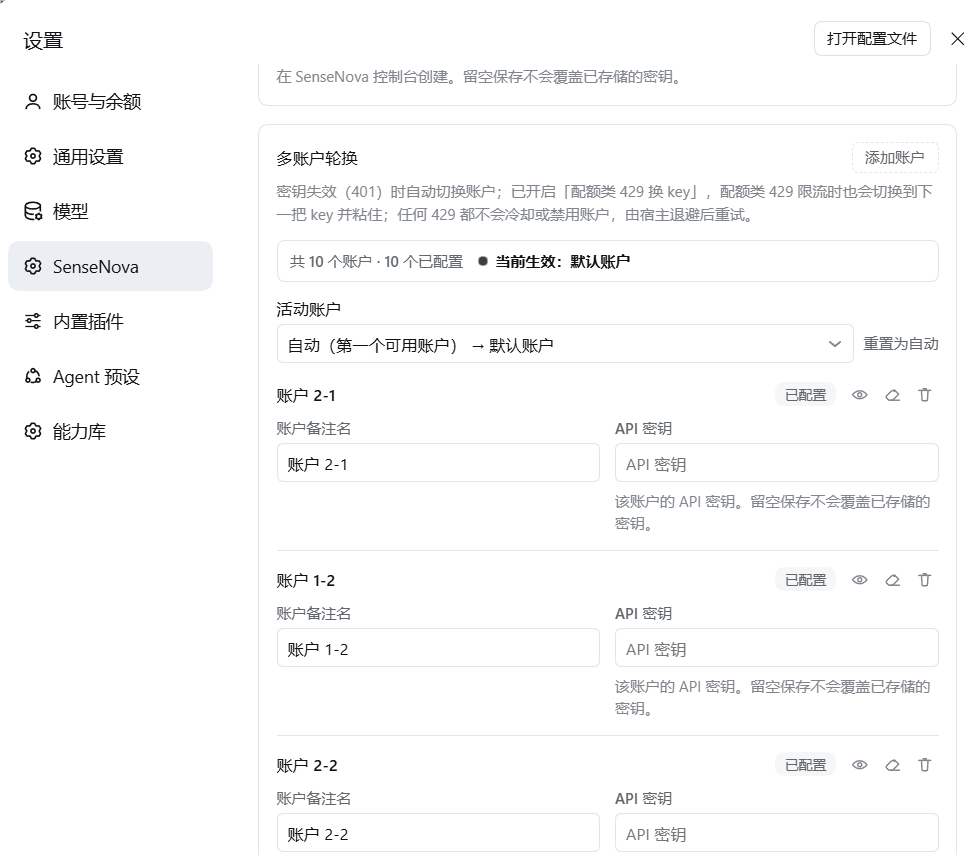
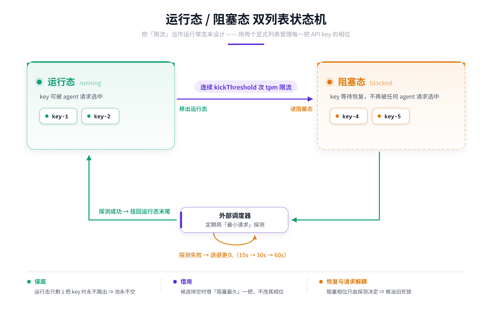

# dsh-sensenova-freeapi

**简体中文** ｜ [English](./README.en.md)

dsh-sensenova-freeapi 是一个非官方的 **DeepSeek Harness**（DSH）LLM 提供商插件，基于**一切皆插件（everything-is-a-plugin）**架构注册 `sensenova` 提供商路由，对接 **SenseNova**（OpenAI 兼容 API）。它内置**多账户 API-Key 轮换**、**运行态 / 阻塞态双列表状态机**、实时模型目录与 Models 页设置面板，把渠道限流从「错误轰炸」变成「稳定服务」。

<p align="center">
  
</p>


> 参考实现：[`@mars-sea/dsh-commandcode-provider`](https://github.com/Mars-Sea/dsh-commandcode-provider)（MIT）。本插件只保留多账户连接能力；登录流程、用量面板、套餐窗口、命令行工具均已裁剪。

---

## 🚀 快速上手：注册、申请 Key、配置账户

### 1. 注册 SenseNova 账号

到 [https://platform.sensenova.cn/login](https://platform.sensenova.cn/login) 注册并登录（支持手机号 / 邮箱）。

### 2. 在控制台申请多个 API Key

进入控制台 [https://platform.sensenova.cn/console](https://platform.sensenova.cn/console)，在「API Key 管理」中创建密钥。**每个账户最多可申请 20 把 Key**。注意额度是按**账户**计量的（同一账户内多把 Key 共享一个桶），但同账户内多把 Key 能显著提升「抽签次数」——实测同账户 20 把成功率约 90%，单把只有 30%。

> 📷 账户配置界面示意（控制台申请多个 API Key 的位置）：

<p align="center">
  
</p>

### 3. 建议注册多个账户（推荐 4 个）

SenseNova 的限流额度是**账户级 / 端点级**的（同一账户内多把 Key 共享同一个额度桶），因此**把 API Key 分散到 ≥ 2 个账户**才能绕开单账户瓶颈。

- **多账户是关键**：每个账户拥有独立限流额度桶，账户数 = 桶数。实测 4 账户 × 20 把 = 4 个独立桶 × 20 次抽签，成功率从单账户 30% 拉到接近 100%。
- 本插件运行态/阻塞态双列表 + 账户轮换就是为「多账户」设计的。

### 4. 建议 API Key 输入顺序：按账户交替

在 Models 页配置 `accounts[]` 时，把**不同账户的 Key 交替排列**，例如有 2 个账户 `A`、`B`，则填写顺序为：

```
A1  B1  A2  B2  A3  B3  …（即 121212 交替）
```

这样每把 Key 之间天然错位，轮换时不会在同一账户内打转，显著降低单账户触顶概率。

- **推荐配置：4 个账户 × 每账户 20 把**（SenseNova 每账户最多 20 把）。

  实测结论（2026-10，晚高峰 10 轮对照）：

  | 同账户 key 数 | 成功率 | 期望耗时 |
  |---|---|---|
  | 1 把 | 30% | 27.9s |
  | 5 把 | 40% | 27.1s |
  | 10 把 | 40% | 27.8s |
  | 15 把 | 70% | 21.9s |
  | **20 把** | **90%** | **17.2s** |

  **成功率拐点在 15~20 把**；20 把同账户 ≈ 跨账户 20 把（90% vs 100%）。每账户 20 把，4 账户就是 4 个独立桶 × 20 次机会，晚高峰也基本不失败。

### 5. 推荐模型

以下结论来自垃圾站长程实测校准（2026-09），按首选用途排序：

| 模型 | 能力 / 说明 | 推荐度 |
|---|---|---|
| **`deepseek-v4-flash`** | **首选**。DeepSeek V4 Flash（0731），任意时段使用都只比 DeepSeek 官方 API **慢一点点**；低成本、1M 上下文、支持思考/工具调用 | ⭐⭐⭐⭐⭐ |
| `sensenova-6.8-flash-lite` | `6.8-flash-lite` 走轻量专属额度池，**真视觉**（读图、截图唯一可靠）、墙钟最快（26.6× 提速） | ⭐⭐⭐⭐⭐（读图首选） |
| `kimi-k3` | 月之暗面旗舰多模态 Agent，原生态视觉 + 1M 上下文，适合长程编程/知识工作 | ⭐⭐⭐⭐ |
| `glm-5.2` | 智谱长程 Agent，**持续吞吐最高**（比 `deepseek-flash` 快 201%、延迟快 45%），但**无视觉**（读图会幻觉） | ⭐⭐⭐⭐（纯文本/长程） |
| ⚠️ `deepseek-flash`（DeepSeek V4.1 Flash） | **不建议**：实测高峰期很慢、低峰期也只能达到官网 API 一半速度及以下 | ❌ |

> 💡 **一句话结论**：日常/代码/Agent 用 `deepseek-v4-flash`；要读图用 `sensenova-6.8-flash-lite`；追求极限文本吞吐且不读图用 `glm-5.2`。**不要用 `deepseek-flash`（V4.1）**。

> 🔭 **搭配推荐（视觉辅助）**：主模型用 `deepseek-v4-flash`（快且稳、成本低），图片识别交给视觉辅助插件 —— 安装 [`dsh-sensenova-vision-aid`](https://github.com/modesthub/dsh-sensenova-vision-aid) 后，收到图片识别请求会自动派生子 agent 切换到 SenseNova 视觉模型（`sensenova-6.8-flash-lite` → `deepseek-flash` → `kimi-k3` 故障转移），并**自动复用本插件同一把 key**（默认 `reuseFreeapiCredentials=true`，无需再配第二把 key）。**最合适的组合：`deepseek-v4-flash` 处理文本/代码/Agent + vision-aid 辅助视觉**，又快又好。

---

## 核心思想：把「限流」当作常态设计

SenseNova 渠道对单 key 存在 **TPM / RPM 并发与配额限制**，瞬时超限会抛 `429`。多数插件的做法是报错 + 重试，连续限流时陷入**正反馈死锁**：计数只在 2xx 清零 → 短路导致零成功 → 计数永不清零 → 短路永不解除 → 只能重启进程。

本插件换了一个思路：**限流不是事故，是运行常态**。用两个显式列表管理每一把 API Key 的状态：

### 运行态 / 阻塞态双列表状态机

<p align="center">
  
</p>

三条不可让步的性质（与旧「全池短路」机制的本质区别）：

1. **保底**：运行态只剩 1 把 key 时永不踢出 ⇒ 池永不空，Agent 请求永远发得出去。
2. **借用**：运行态候选被排除排空时，从阻塞态借「阻塞最久」的一把临时使用（**不修改其相位**）。
3. **恢复与请求解耦**：阻塞态 Key 的相位**只由探测结果决定**，不受「零成功」污染，随时能把 key 救回运行态。**这是根治旧死锁的关键。**

> 为什么必须探测恢复：Agent 请求只会选中运行态的 Key，阻塞态的 Key 不会被任何请求命中。若无人试探，它就永远回不来——调度器每 `probeInitialMs`（默认 3s，2026-10 实测调密）用一次最小请求探一下，成功即复活。

---

## 轮换机制：先原地重试，再换 key

**撞 429 后的完整处理链路**：

1. **插件内原地等重试**：同一把 key 等 `deepseek-flash` 15s / `deepseek-v4-flash` 10s，最多 1 次。成功即继续 —— 不换 key、不产生日志噪音。
2. **换 key 轮换**：仍失败且 `quotaRotation=true`（推荐）时，从上次使用的 key 的**下一个位置**在运行态里环回，跳过本轮已试过的 key（`exclude`），避免旧实现「前两把反复、第 3+ 把轮不到」的问题。
3. **借用阻塞态**：运行态候选全部被排除时，从阻塞态借用「阻塞最久」的一把临时使用（**不改变其相位**），使一轮内仍能试满全部 key。
4. **抛宿主**：全部 key 都失败才抛给宿主（指数退避 15~19s，最多 24 次重试）。

**实测对照（强制 429 后 6 轮，deepseek-flash / 80 key / 24k tokens）**：

| 策略 | 成功率 | 成功均耗时 | 耗时范围 |
|---|---|---|---|
| **`quotaRotation=true`**（先 15s 重试，再换 key） | **6/6（100%）** | **27.9s** | **25.9~28.7s** |
| `quotaRotation=false`（先 15s 重试，不换 key） | 4/6（67%） | 36.9s | 27.4~46.4s（2 次失败在 50s） |

> 为什么轮换更快：换 key 的成本是 **0.2s/把**（平均试 2~4 把就命中），而宿主退避是 **17s/次**。即使多撞几次 429，轮换的总耗时也稳定在「15s 等待 + 12~15s 生成」≈ 28s；不换 key 则只能等宿主退避，撞两次就是 45~50s 甚至失败。

**状态与限流分类**：

- 只有 **tpm 类 429** 才会累计「连续命中」，达到 `kickThreshold`（默认 2）才把 key 踢进阻塞态；`rpm` / `rate` 类只记录、不踢出（秒级桶自愈快，踢掉只会损失 prompt cache）。
- **保底**：运行态只剩 1 把时永不踢出，池不会空，agent 请求永远发得出去。
- **401（凭据无效）**：永久禁用并从池中移除，不受 `quotaRotation` 开关影响。
- **会话粘性**：轮换后会话粘住新 key（保护服务端 prompt 缓存）；请求成功即清除粘性，让环回游标主导下一次选择。
- **探针的已知局限**：阻塞态探针是最小请求（`max_tokens: 1`、关闭思考），只能代表「请求数桶」恢复，不能完全代表大请求（TPM）恢复；大请求的真实可用性以 agent 请求本身为准。

---

## 为什么能「长时间稳定运行」——长程实测支撑

本项目所有关键参数都不是拍脑袋，而是**在长程运行中实测校准**的：

| 实测项 | 结论 | 依据 |
|---|---|---|
| 429 处理顺序 | **先原地重试 1 次，再换 key**（deepseek-flash 15s / v4-flash 10s） | 6 轮强制 429 对照：成功率 100% vs 67%，耗时 27.9s vs 36.9s |
| `quotaRotation` | **开启**（换 key 是低成本快速抽签，0.2s/把） | 同上：不换 key 时宿主退避 17s/次，撞两次即 45~50s |
| 同账户 Key 数收益 | 20 把成功率 **90%**（单把 30%）；拐点在 15~20 把 | 晚高峰 10 轮 × 5 档对照 |
| 池容量 | **100**（容纳 4 账户 × 20 把） | 2026-10 扩容实测 |
| 探测间隔 | **3s 固定**（`probeBackoffFactor=1`，不放大） | 实测调密：更快把恢复的 key 捞回运行态 |
| 探测恢复 | 外部调度器每 tick 至多探 1 把（防探测自身形成突发） | 设计 |
| 双列表状态机 | 取代「全池饱和短路」正反馈死锁 | 重构 |
| 环回轮换修复 | 排除项后必须从下一位置环回 | 9265 条 429 日志统计 |
| Retry-After 上限 | 提到 `60_000ms`（原 3000ms 与 TPM 60s 窗口量级不符） | 长程实测 |
| 排队超时 | 默认 60s，与 TPM 窗口对齐，排队必须有界 | design D4/D6 实测 |

---

## 功能一览

### 🧠 双列表 Key 池（运行 / 阻塞）
- 池级单例、跨会话共享：Key 的额度是全局属性，不该被会话隔离。
- 连续限流踢出、保底不空、借用最久阻塞、探测恢复（3s 固定），全部可配置。
- 每把 Key 状态（相位、strikes、blockedSince、probeAttempts）在设置页只读展示。

### 🔄 轮换机制
- 默认账户 + 多额外账户，同 base URL。
- 环回轮换 + 配额类 429 粘性换 Key + 401 永久禁用。
- 被禁用 Key 凭据修改后自动恢复。

### 📋 错误记录表（只读诊断区块）
- 每次限流落成一条结构化事件，异步写入、**绝不阻塞、绝不抛出**。
- 字段：`time / model / error.code / account fingerprint / retryFloorMs / probeHits / poolRunning / poolBlocked / rotated / attempt`。
- 密钥只存内存、日志只写 **sha256 指纹**，Key 原文永不落盘、永不出境。

### 📊 「当前模型 + 全部参数」面板（只读可视化）
- 回答三个问题：**我现在用的是哪个模型？它支持什么？哪些参数可以改？**
- 数据来自宿主实际解析 + 多轮实测校准。

---


### 🔑 Key 导入 / 导出（v0.2.1）
- **导出**：一键拉取全部账户（含默认账户）的密钥，按 `账户N` 分节写到文本框，纯本机操作、不上传。
- **导入**：粘贴「`账户N` + `序号:密钥`」分块或「`标签:密钥`」单行，自动匹配已有账户（标签相同则覆盖密钥），其余分配新 ref 并新增账户。
- 导出走 host 只读路由 `GET /api/sensenova/keysExport`（客户端读不到明文，必须由宿主 `credentials.resolve` 解析）；导入直接写凭据域并更新 `accounts`。
## 导入 / 导出 Key（v0.2.1）

设置页「凭据与账户」下方新增 **导入 / 导出 Key** 卡片：

**导出**：点「导出全部 Key」→ 全部账户（含默认账户）的密钥以明文写入文本框，格式与手工整理的密钥文件一致：

```
# dsh-sensenova-freeapi key export — 2026-10-26T00:00:00.000Z
Default:sk-...

账户2
0:sk-...
1:sk-...
```

**导入**：把上述文本（或你自己整理的「账户N / 序号:密钥」「标签:密钥」）粘进文本框，点「导入到账户」：

- 标签与已有账户相同 → 覆盖该账户的密钥（不改账户结构）
- 新标签 → 从 `SENSENOVA_API_KEY_2` 起分配新 credential-ref 并追加账户
- `Default` / `1-0` → 写入默认账户
- 重复密钥、非法行会被跳过并在下方提示（不阻断其它行）

> 🔒 导出文本是**明文密钥**：只在本机设置页显示，插件不上传、不落盘；请自行决定保存位置（建议放在密码管理器）。

> 🛠️ **v0.2.2 修复**：导入新账户时不再误报「写入失败」——旧版按 `describe` 回读判定，而新 ref 尚未进入设置快照；现在以 `credentials.set` 的返回值为准，并在账户落盘后统一刷新状态。

> 🛠️ **v0.2.3 修复**：批量导入导致界面卡死——宿主的 `credentials/reference-updated` 是逐条广播，旧代码每写一把 key 就全量 `describe` 一次（80 把 = 80 次全量查询）。现在事件入口改为 **200ms 防抖**，导入循环内直接**挂起**刷新，结束后只查一次；同时新增「设置尚未就绪」守卫，避免快照未就绪时写 `accounts` 抹掉既有账户。

---

## 安装

```bash
# 本地路径装入（推荐用于接入 DSH 验证）
dsh plugin --profile <name> add /path/to/dsh-sensenova-freeapi

# GitHub 发布后
dsh plugin --profile <name> add github:modesthub/dsh-sensenova-freeapi

# 或 npm 发布后
dsh plugin --profile <name> add dsh-sensenova-freeapi
```

然后在「模型」页配置 SenseNova：
- 默认凭据环境变量：`SENSENOVA_API_KEY`
- 默认 base URL：`https://token.sensenova.cn/v1`

---


## 配置项

| 字段 | 类型 | 默认 | 含义 |
| --- | --- | --- | --- |
| `apiBase` | string | `https://token.sensenova.cn/v1` | 所有账户共享的 base URL |
| `apiKeyEnv` | credential-ref | `SENSENOVA_API_KEY` | 默认账户凭据引用 |
| `accounts[]` | array | `[]` | 额外账户：`{ id, label, apiKeyEnv }` |
| `activeAccount` | string | `""` | 首选账户 id；空 = 自动 / 首个可用 |
| `quotaRotation` | bool | true（推荐） | 配额类 429 跨账户换 Key（2026-10 实测：换 key 是"低成本快速碰运气"，20 把轮换成功率 ~90%，远优于硬等） |
| `concurrency` | int | 1 | 每 Key 并发闸上限（达限排队 FIFO） |
| `queueTimeoutMs` | int | 60000 | 排队等待上限 |
| `poolPolicy.kickThreshold` | int | 2 | 连续多少次 tpm 限流踢出运行态 |
| `poolPolicy.probeInitialMs` | int | 3000 | 阻塞态 key 每 3 秒探测一次恢复（2026-10 实测，更快捞回） |
| `poolPolicy.probeBackoffFactor` | int | 1 | 探测失败退避倍率（1 = 固定间隔，不放大） |
| `poolPolicy.probeMaxMs` | int | 3000 | 探测间隔上限（固定 3s） |
| `poolPolicy.capacity` | int | 100 | 池容量上限（100 槽，容纳 4 账户 × 20 把） |
| `connectRetry.maxRetries` | int | 1 | 撞 429 后插件内原地重试次数（省去宿主 16~19s 退避空转） |
| `connectRetry.waitMs` | int | 模型相关 | deepseek-flash 15s / deepseek-v4-flash 10s；modelWaitMs 可覆盖 |
| `errorLog` | bool | true | 是否记录限流事件到错误日志 |

> API Keys 一律经 DSH 凭据服务存储，**永不写入日志、永不发送给模型**。

---

## 开发

```bash
pnpm install
pnpm run typecheck
pnpm run build    # tsdown → lib/
pnpm test         # node --import tsx --test tests/**/*.test.ts
```

---

## 许可证

MIT