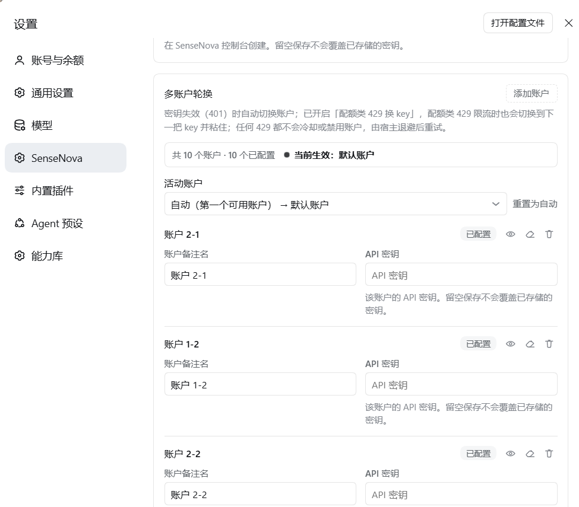

# dsh-sensenova-freeapi

**简体中文** ｜ [English](./README.en.md)

dsh-sensenova-freeapi 是一个非官方的 **DeepSeek Harness**（DSH）LLM 提供商插件，基于**一切皆插件（everything-is-a-plugin）**架构注册 `sensenova` 提供商路由，对接 **SenseNova**（OpenAI 兼容 API）。它把渠道限流从「错误轰炸」变成「可预期的节奏」：**按账户轮转 + 每账户 4 把一组顺序试探 + 组间定时冷却**，再配一套**可视化控制台**，让你自己看清节奏、自己调参。

<p align="center">
  
</p>


---

## 这一版变了什么（v0.5）

如果你用过旧版本，只需要记住这几条：

| 变化 | 说明 |
|---|---|
| 🔄 **轮换机制重做** | 不再用「运行态 / 阻塞态双列表 + 探测复活」。改成**按账户循环**，单轮只打某个账户的 4 把 key，然后整组让位（组间定时），**从源头避免 424**。 |
| 🎛️ **新控制台面板** | 可视化 key 网格：拖框分组、看轮转顺序、一键「智能分组」、一键「智能组间定时」，还能「演示红/绿」预览两轮节奏。 |
| 👁️ **视觉辅助已融合** | 读图不再另装插件（也不再抢同一批 key 导致互相限流）。三个视觉工具 + 拖图自动识别都在本插件内，可单独关闭。 |
| ⚠️ **AIMD 自适应间隔未完善** | 请**只用固定间隔模式**。AIMD 水合逻辑仍在调试，别用、也别自己改着用。 |
| 📉 **模型推荐取消** | 模型表现随**时段**剧烈波动，推荐表没有意义。改为教你**自己用面板调**出最适合的组间间隔。 |

---

## 安装与更新

### 通过 DSH 插件界面安装（推荐）

1. 打开 DSH → 左侧「插件」→「添加插件」
2. 粘贴仓库地址：

```
https://github.com/modesthub/dsh-sensenova-freeapi
```

3. 确认安装，然后**重启 DSH** 使插件生效
4. 安装后可在**插件详情页**看到当前版本号（本 README 对应 **v0.5.1**）

### 更新到最新版

- 在插件安装界面**重新输入同一个地址**（或先卸载再安装）即可拉取最新代码
- 更新后**重启 DSH**，插件详情页的版本号会随之变化 —— 这是确认是否更新成功最直接的方式
- 想固定到某个版本，可在地址后追加 tag，例如 `https://github.com/modesthub/dsh-sensenova-freeapi#v0.5.1`

### 命令行安装（备选）

```bash
# GitHub（推荐，装完即可用，lib/ 已预构建）
dsh plugin --profile desktop add https://github.com/modesthub/dsh-sensenova-freeapi

# 本地路径（用于开发调试）
dsh plugin --profile desktop add /path/to/dsh-sensenova-freeapi
```

---

## 🚀 快速上手：注册、申请 Key、配置账户

### 1. 注册 SenseNova 账号

到 [https://platform.sensenova.cn/login](https://platform.sensenova.cn/login) 注册。

> ⚠️ **注册 / 登录目前只支持手机号，不支持邮箱。** 邮箱验证码登录在控制台里没有入口，别在邮箱那栏浪费时间。

### 2. 在控制台申请多个 API Key

进入控制台 [https://platform.sensenova.cn/console/keys](https://platform.sensenova.cn/console/keys)，在「API Key 管理」中创建密钥。

- **每个账户最多 20 把 Key**
- 额度按**账户**计量：同一账户内多把 Key 共享一个额度桶
- 多把 Key 的价值在于**同一桶内的重试机会**，不是叠加额度

> 📷 账户配置界面示意（控制台申请多个 API Key 的位置）：

<p align="center">
  
</p>

### 3. 建议注册多个账户（推荐 4 个）

额度是**账户级**的，因此**把 Key 分散到 ≥2 个账户**是绕开单账户瓶颈的唯一办法。账户数 = 独立额度桶数。

- **推荐配置：4 个账户 × 每账户 20 把**（共 80 把）
- 账户数直接决定「组间定时」该给多少（见下文「智能组间定时」）

### 4. 导入 Key

控制台面板里点「**导入到账户**」，支持两种格式：

```
# 格式一：账户分块
1
0:sk-xxxx
1:sk-xxxx
2:sk-xxxx

# 格式二：单行标签:密钥
1-0:sk-xxxx
1-1:sk-xxxx
```

标签规则：`账户号-序号`（如 `2-3` = 账户 2 的第 3 把），`Default` 等同 `1-0`。

导入后会自动执行一次「**智能分组**」（每账户 4 把一组），点顶部「**保存**」写入并生效。

### 5. 选模型

**插件不再给模型推荐**。原因很简单：

> 模型表现随时段剧烈波动（早高峰 / 晚高峰 / 凌晨完全不同），而且每次测试要消耗大量真实请求与时间，**测试时间段本身也是变量**。在这种条件下给出的推荐表，只会误导你。

正确的做法是：**选一个你想用的模型，然后用本插件的面板调组间间隔** —— 面板里有「智能组间定时」和「演示红/绿」，你能直接看到节奏是否合适。

关于模型现状（2026-11 口径）：

| 情况 | 说明 |
|---|---|
| `deepseek-v4-flash` | **即将下线**（新版官方文档已删除该章节）。不建议再作为主力。 |
| `deepseek-flash`（V4.1） | `deepseek-v4-flash` 下线后的**替代选择**。 |
| 响应时间 | 作者个人体感：以上两者都是 **10~20s 量级**。仅代表作者使用体验，非基准测试。 |
| `glm-5.3` | 智谱新一代旗舰（编程 / 安全方向）。**思考常开不可关**，推理档位只有 `low`/`high`/`max`。 |
| `sensenova-6.8-flash-lite` | 轻量多模态，读图首选，上下文 262K。 |
| `sensenova-6.8-flash` | 新一代多模态智能体，1M 上下文，思考常开。 |
| `kimi-k3` | 原生多模态，1M 上下文，适合长程编程。 |
| `glm-5.2` | 已被 5.3 取代，插件里**保留登记**不删（老配置不报错），后续版本迭代再清理。 |

---

## 🎛️ 控制台面板

设置页里的「SenseNova 控制台」是本插件的核心。它分成几块：

### 账户与分组（key 网格）

一个账户一行，每把 key 一个方块，组用带序号的框圈起来（`1`、`1′`、`1″`）。

| 操作 | 怎么做 |
|---|---|
| **改变分组** | 拖组框的**左/右边缘**，在相邻组之间挪 key（拖到头就停） |
| **组菜单** | 点组标签 → 并入前/后组、整组移出轮换、删组 |
| **账户菜单** | 点行首账户方块 → 重命名、删除 |
| **加 key** | 点空位 → 在下方面板填 API 密钥 → 「添加密钥」 |
| **行尾 +** | 末尾有孤立 key → 收编成新组；否则从最后一组切分 |

行内 20 个预留位，超出自动扩展。孤立 key（黄色虚线）属于该账户但**不参与轮换**。

### 演示红/绿

按**真实轮转顺序**加速播放：每把 key 先绿（请求在飞）后红（429），走满「429 轮次预算」轮后显示「抛宿主」。

用途：调参前先看一眼顺序对不对、两轮是否覆盖全部 key。

### 智能分组

把每个账户按 **4 个一组**重排（末尾不足 4 个自成一组）。**导入后自动执行一次**，也可以随时手动重做。

> 为什么是 4 个一组：单轮只打 4 把，是「防止连续请求触发 424」的经验值（424 是上游对**连续限流**的熔断信号）。想让一组更多/更少，手工拖框即可。

### 智能组间定时

按**实际接入账户数**推荐组间定时：

| 账户数 | 推荐组间定时 | (n−1) × 定时 |
|---|---|---|
| 1 / 2 | 60s | 0 / 60s |
| 3 | 30s | 60s |
| 4 | 20s | 60s |
| ≥5 | 20s（可手动调低） | ≥80s |

约束是 `(账户数 − 1) × 组间定时 ≥ 60s`：让每个账户在两次使用之间至少休息 60 秒。面板下方会显示当前账户数对应的**推荐值**与**手动下限**。

### 调度（固定间隔）

| 参数 | 默认 | 含义 |
|---|---|---|
| **调度模式** | 固定间隔 | ⚠️ 只用这个。AIMD 未完善。 |
| **分组形状** | 一组一个账户 | 另一种「组内混账户」用于吞吐优先场景 |
| **组内 key 间隔** | 1000ms | 同账户内换下一把 key 前的等待 |
| **组间定时** | 20000ms | 每组本轮的最低占用时长 |
| **429 轮次预算** | 2 | 走完几轮完整遍历仍全 429 就抛宿主（1~10） |

### 视觉辅助

三个工具（`describe_image` / `describe_images` / `chat`）+ 拖图自动识别。**勾选/取消立即生效**，不用点保存。关闭后主对话不受影响。

### 诊断 / 当前模型

只读区块：运行日志（限流/视觉/全部三种过滤）、当前模型能力与全部参数。不参与保存流程。

---

## 🔄 轮换机制（v0.5 核心）

这是本版本最大的改动。旧版用「运行态 / 阻塞态双列表」管理每一把 key 的相位，需要外部探针把 key 从阻塞态救回来 —— 逻辑复杂、失败模式也多。新版改用**纯节奏驱动**，不再有相位机。

### 一轮是怎么走的

以 4 账户 × 每账户 20 把 × 每 4 把一个组（5 组）为例：

```
账户1 第1组(4把) → 账户2 第1组 → 账户3 第1组 → 账户4 第1组
                 ↓ 一组完成后等待「组间定时」
账户1 第2组(4把) → 账户2 第2组 → 账户3 第2组 → 账户4 第2组
                 ↓
... 直到每账户的 5 组都走过一遍
```

**三个层次的规则：**

1. **宏观：按账户循环，永不跳过**
   每个宏观周期按账户顺序各走一步。账户 1 走完才轮到账户 2。不跳过账户 —— 跳过会把同一账户的两次使用挤到一起，而限流是按账户连锁的。

2. **微观：轮到某账户时，用它自己的组游标**
   每个账户各自记录「下一次该用第几组」。组数少的账户会重复用同一组，这是设计的一部分。

3. **组内：4 把 key 按 slot 顺序请求**
   第 1 把 → 429 → 等「组内 key 间隔」→ 第 2 把 → … → 第 4 把。
   任一成功即可；4 把全 429 则这一组本轮用完。

### 组间定时怎么起作用

一组用完后（不管成功还是 4 把全败），插件记录**本组开始使用的时刻**，并要求该组在 `开始时刻 + 组间定时` 之前不再参与轮换。

- 如果本轮只花了 2 秒就打完，而组间定时是 20 秒 → **补等到 20 秒**
- 补等期间，指针继续走向下一个账户的下一组

于是当轮转**再次回到这个账户的同组**时，已经过去了：

$$(账户数 - 1) \times 组间定时$$

以 4 账户 × 20 秒为例：同一账户两次使用之间至少间隔 **60 秒**。这就是「账户得到休息」的实现方式，也是组间定时这个参数唯一需要你理解的语义。

### 429 之后怎么办

| 情况 | 动作 |
|---|---|
| 组内还有没试过的 key | 等「组内 key 间隔」，换下一把 |
| 本组 4 把全失败 | 记账，走一步宏观轮转，切到下一个账户 |
| 所有账户的当前组都不可用 | 等最早可用组，清空「本轮已试」记录，进入下一轮 |
| 走满「429 轮次预算」 | 抛给宿主，附 `pra = 最早可用组的剩余时间` |

**为什么这样能避免 424**：424（`bili_throttle_terminal`）是上游对**连续限流**的熔断信号 —— 一旦触发，换 key、换账户都没用，只能按探针周期（约 30s）干等。旧版的「撞 429 立刻换 key」会在几百毫秒内连发十几次请求，正是 424 的触发器。新版每组最多 4 次请求，且组与组之间有秒级间隔，从根本上不给熔断机会。

### ⚠️ 关于 AIMD

面板里的「AIMD（自适应）」模式**目前不可用**：撞 429 就放大间隔的逻辑与固定间隔模式共用了一套状态，水合不完整。请使用**固定间隔**。也请不要自己改代码启用它 —— 短期内不会有大型更新。

---

## 👁️ 视觉辅助（已融合）

旧版需要额外安装 `dsh-sensenova-vision-aid`，两套轮换抢同一批 key，结果就是**主对话和视觉请求互相限流**。

现在视觉能力直接内置：

| 能力 | 说明 |
|---|---|
| `describe_image` | 单图理解 / OCR |
| `describe_images` | 多图一次请求 |
| `chat` | 纯文本（连通性验证 / 兜底） |
| 拖图自动识别 | 纯文本主模型拖入图片时，先转成「视觉观察」文本再交给主模型 |

关键点：**视觉请求与主对话共用同一套 key 池、同一并发闸、同一套组退避**。限流事件也写进同一份运行日志。

**如果你不想用**：设置页勾掉「启用视觉辅助」即可，立即生效。此时拖图会交给主模型按自身能力处理（官方视觉模型能直接看图，纯文本模型由宿主拒绝），行为等同于没装视觉插件。

---

## 🔑 导入 / 导出 Key

**导出**：点「导出全部 Key」→ 全部账户（含默认账户）的密钥以明文写入文本框：

```
# dsh-sensenova-freeapi key export — 2026-11-12T00:00:00.000Z
Default:sk-...

账户2
0:sk-...
1:sk-...
```

**导入**：粘贴文本 → 点「导入到账户」→ **只写草稿**（保存按钮亮起）→ 点「保存」才真正写凭据。

- 标签与已有账户相同 → 覆盖该账户的密钥
- 新标签 → 自动分配新 credential-ref 并追加账户
- 重复密钥、非法行会被跳过并提示（不阻断其它行）

> 🔒 导出文本是**明文密钥**：只在本机设置页显示，插件不上传、不落盘。导出走宿主只读路由 `GET /api/sensenova/keysExport`（客户端读不到明文，必须由宿主解析）。

---

## 界面按钮一览

| 按钮 | 位置 | 作用 |
|---|---|---|
| **重置 / 保存** | 页面标题右侧 | 放弃未保存的修改 / 保存所有草稿 |
| **刷新** | 标题右侧 | 强制重读全部凭据状态（导入后渲染异常时点它） |
| **清空全部** | 账户卡片标题右侧 | 二次确认后暂存移除全部额外账户，保存才生效 |
| **演示红/绿** | 分组编辑器顶部 | 按真实顺序加速播放两轮 |
| **智能分组** | 同上 | 每账户按 4 个一组重排 |
| **智能组间定时** | 调度卡片 | 按账户数写入推荐值 |
| **导出全部 Key / 导入到账户 / 清空文本框** | 导入导出卡片 | 见上节 |
| **刷新**（诊断） | 诊断卡片 | 拉取最近运行日志 |

---

## 配置项

| 字段 | 类型 | 默认 | 含义 |
|---|---|---|---|
| `apiBase` | string | `https://token.sensenova.cn/v1` | 所有账户共享的 base URL |
| `apiKeyEnv` | credential-ref | `SENSENOVA_API_KEY` | 默认账户凭据引用 |
| `accounts[]` | array | `[]` | 额外账户：`{ id, label, apiKeyEnv }` |
| `activeAccount` | string | `""` | 首选账户 id；空 = 自动 |
| `quotaRotation` | bool | `true` | 配额类 429 跨 key 换（推荐开） |
| `concurrency` | int | `1` | 每 key 并发闸上限（达限 FIFO 排队） |
| `queueTimeoutMs` | int | `60000` | 排队等待上限 |
| `errorLog` | bool | `true` | 是否把限流事件写入运行日志 |
| `scheduling.mode` | enum | `fixed` | ⚠️ 只用 `fixed`，`adaptive`（AIMD）未完善 |
| `scheduling.grouping` | enum | `by-account` | 一组一个账户 / 组内混账户 |
| `scheduling.groups[]` | array | `[]` | 每账户的组切分 `{ account, sizes[], gaps[] }` |
| `scheduling.keyGapMs` | int | `1000` | 组内换 key 的等待 |
| `scheduling.groupGapMs` | int | `20000` | 组间定时（每组最低占用时长） |
| `scheduling.roundBudget` | int | `2` | 多少轮全败后抛宿主 |
| `vision.enabled` | bool | `true` | 视觉辅助总开关（立即生效） |
| `vision.modelChain` | string | `sensenova-6.8-flash-lite,deepseek-flash,kimi-k3` | 视觉故障转移链 |
| `vision.bridgeMode` | enum | `on` | 拖图桥：`on` / `auto` / `off` |
| `poolPolicy.capacity` | int | `100` | key 池容量上限 |

> API Keys 一律经 DSH 凭据服务存储，**永不写入日志、永不发送给模型**。

---

## 调参思路（代替模型推荐）

既然模型表现随时段波动，**唯一有效的办法是自己测**。步骤：

1. **先跑「智能分组」** —— 每账户 4 个一组
2. **再点「智能组间定时」** —— 按你的账户数写入推荐值
3. **点「演示红/绿」看顺序** —— 确认两轮覆盖全部 key、账户轮转连贯
4. **实际用一段时间，观察限流日志**
   - 429 密集 → 组间定时调大（每次 +5s 或 +10s）
   - 很少 429 但响应慢 → 组间定时可略调小
5. **组内 key 间隔**：默认 1000ms，调小可加快组内轮换，调到 0 表示 4 把背靠背（网关可能视作突发）

调度参数会随每次请求写进运行日志：`schedMode` / `schedKeyGapMs` / `schedGroupGapMs` / `schedWaitMs`（本次实际等待）/ `schedStep`（组内第几把）。在「诊断 → 运行日志」里能核对实际节奏是否与设定一致。

---

## 开发

```bash
pnpm install
pnpm run typecheck
pnpm run build    # tsdown → lib/
pnpm test         # node --import tsx --test tests/**/*.test.ts
```

---

## 更新日志

按版本先后排列（旧 → 新）。

- 🎉 **v0.2.0**：429 链路重构（原地重试前置 / 按模型等待）+ 容量 100 + 多账户 20 key 实测文档。
- 🎯 **v0.2.1**：Key 导入 / 导出（host 只读导出路由 + 设置页导入面板）。
- 🛠️ **v0.2.2 修复**：导入新账户时不再误报「写入失败」——改以 `credentials.set` 返回值为准。
- 🛠️ **v0.2.3 修复**：批量导入卡死——凭据广播改为 200ms 防抖 + 导入循环内挂起刷新。
- 🛠️ **v0.2.4 修复**：凭据状态查询分批（每批 25）+ 导入改草稿流程 + 顶部手动刷新。
- 🧹 **v0.2.5**：清空全部账户 / 清空文本框（staged，二次确认）。
- ⚡ **v0.2.6**：轮换顺序改为运行时自动交替（按 label 的「序号→账户」排序）。
- 🩺 **v0.2.7**：Key 池状态指示器 + 账户列表折叠 + 池 seed 诊断日志。
- 🐛 **v0.2.8**：`quotaRotation` 默认改开启 + 429 无条件上报池状态（修「80 账户卡 Default」）。
- 🎛️ **v0.2.9**：接通 `connectRetry` 配置入口（429 原地等待终于可关）。
- 🚀 **v0.5.0**：**轮换机制重做** —— 按账户循环 + 每账户 4 把一组 + 组间定时冷却，取代运行态/阻塞态双列表状态机；全新控制台面板（key 网格拖拽分组、智能分组、智能组间定时、演示红/绿、429 轮次预算）；**视觉辅助融合**（三工具 + 拖图桥，共用 key 池）；实时请求闪灯；密钥导入导出重构。
- 🔧 **v0.5.1**：接入 `sensenova-6.8-flash` 与 `glm-5.3`（思考常开，档位仅 low/high/max）；`glm-5.2` 与 `deepseek-v4-flash` 保留登记（下线不删，等版本迭代清理）。README 全面重写（新轮换机制 / 控制台面板 / 视觉融合 / AIMD 警告 / 取消模型推荐），删除双列表状态机图。

---

## 许可证

MIT
